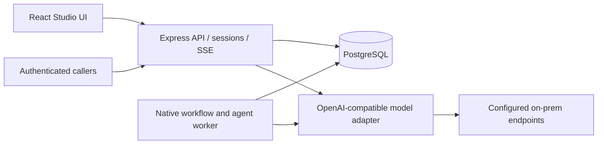

# Architecture

The API serves the built frontend and persists jobs. Workers claim jobs using `FOR UPDATE SKIP LOCKED`, keep 30-second renewable leases, and write results only while they own the lease. PostgreSQL is the coordination system; no Redis or n8n service is required. Local development may use PGlite and an embedded worker in the same process.

`shared/` defines versioned agent/workflow contracts and initial templates. `server/service.ts` validates execution input and freezes agent versions plus model configurations at enqueue time. `server/engine.ts` executes nodes and builder jobs. `server/models.ts` handles credentials, concurrency, inference, streamed assistant text, and bounded structured-output repair. `server/app.ts` exposes the authenticated HTTP interface. `web/` contains the Studio interface.

## Definitions and runs

An entity owns a mutable draft with an optimistic revision number. Publishing stores an immutable numbered copy. A run contains the chosen spec, input, resolved agent/model snapshots, status, and output/error. Node attempts and events are separate persisted records. Builder jobs use the same queue but can only update the revision they started from; they cannot overwrite an intervening user edit.

Standalone model resolution is run override → agent version default → workspace default. Workflow resolution is step override → run override/workflow default → agent version default → workspace default. In-flight runs keep their resolved configuration. Secret values are fetched server-side by reference; intentionally rotating a credential can affect subsequent requests without rewriting published definitions.

## Access and data

The MVP supports an administrator token and a runner token. Administrators manage the workspace. Runners can invoke published agents/workflows, call activated webhooks, and inspect/cancel workspace executions; this is a workspace-wide execution credential, not per-agent RBAC. Browser authentication uses a signed, HttpOnly, SameSite=Strict cookie. Mutating browser requests check Origin. Production requires authentication.

Credentials are encrypted with AES-256-GCM using the deployment’s encryption key, or supplied by environment reference. They are not exported to the browser or workflow JSON. The node HTTP allowlist is separate from administrator-managed inference endpoints. HTTP redirects are rejected. Agent email inputs are untrusted data; generated results are validated against JSON Schema and source-email references.

The original product is independent of Ultimate at runtime, so it can be deployed on Kubernetes. Ultimate can work on this repository as the development agent; its SDK or self-modifying execution environment is not included in the serving process.
